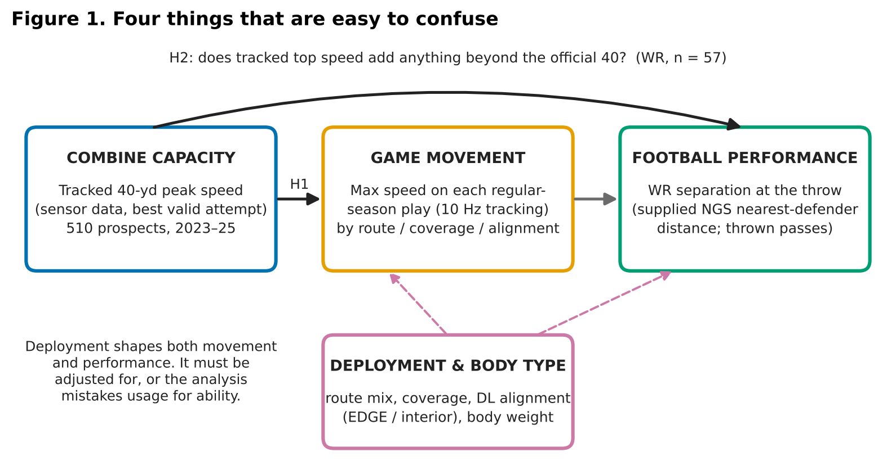
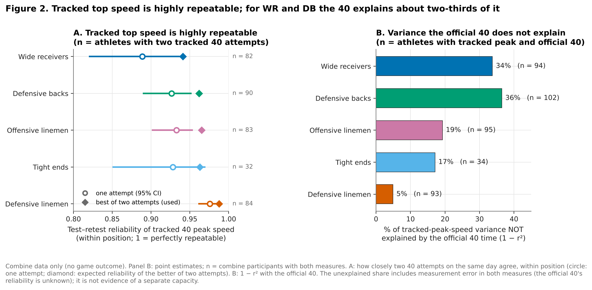
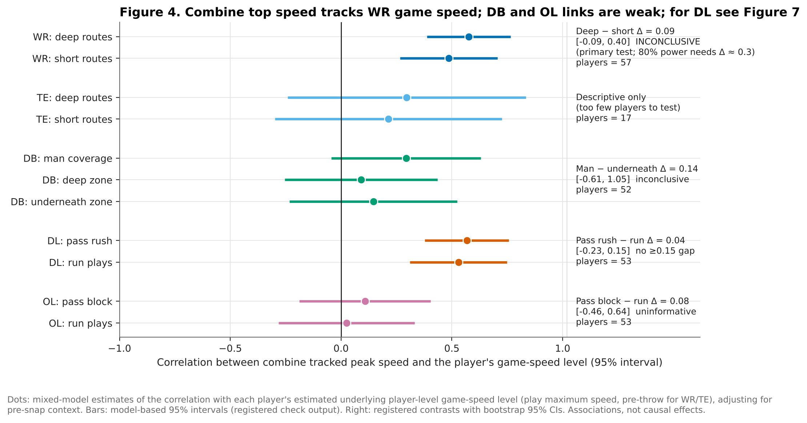
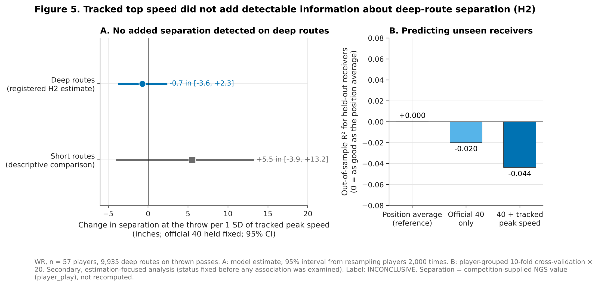
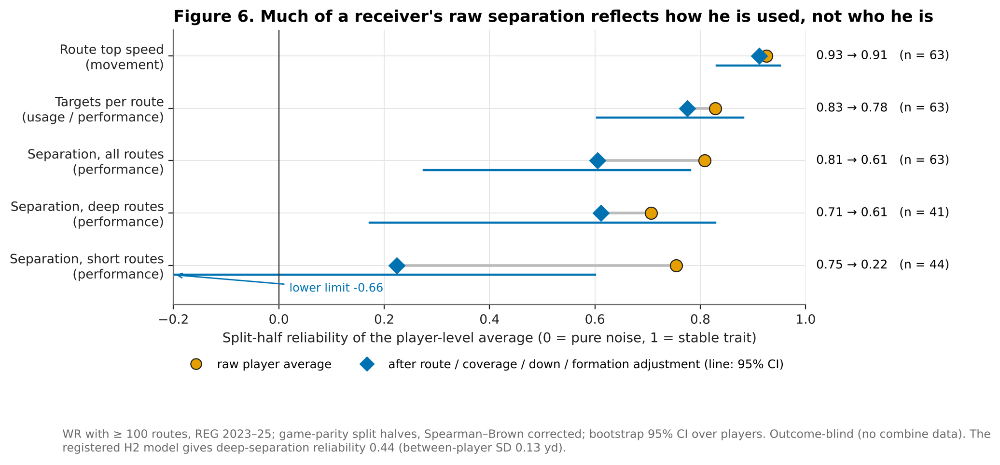

# What Combine Tracking Can and Cannot Tell Us About NFL Game Movement

*A reliability-first study of athletic capacity, game-speed translation and receiver separation · NFL Big Data Bowl 2027*

## 1. The question

When a receiver runs a 4.38, scouts ask: *will they play fast?* and *will they get open?* The 2027 data links Combine sensor tracking to the same players' regular-season tracking (2023–25).

We keep four things separate (Figure 1): **capacity** (tracked 40 peak speed, yd/s); **game movement** (maximum speed on each regular-season play, before the throw for receivers); **performance** (receiver separation at the throw); and **deployment** (route mix, coverage, EDGE or interior alignment, body weight).

## 2. Data and design

- **Cohort.** 510 prospects (2023–25 classes); 418 have at least one valid tracked 40 (clean acceleration curve, peak ≤ 12.5 yd/s); 332 of them also have regular-season game rows.
- **Eligibility.** A player is analysed only with **at least 100 qualifying regular-season opportunities** (routes, coverage snaps, pass rushes or pass blocks).
  - This selects the sample. Eligible receivers were drafted much higher than ineligible receivers but were only about 0.02 seconds faster on the official 40. Nothing here predicts draft busts or career success.
- **Unit of analysis: the player, not the play.** Final samples:

| position | players | plays |
|---|---|---|
| WR | 57 | 19,960 |
| DL | 53 | 34,154 |
| OL | 53 | 64,285 |
| DB | 52 | 16,643 |
| TE (descriptive only) | 17 | 4,170 |

- **Safeguards.** The plan was pre-registered and the code frozen before the single Combine-to-game join; the pipeline was first tested on simulated data.
- **Model.** A mixed model estimates each player's estimated underlying player-level game-speed level in each context, adjusting for route, coverage, down, distance, formation, time to throw, season, NFL year and team-season. We report its correlation with Combine peak speed, ρ (from −1 to 1; 0 means no linear relationship), with intervals from resampling players 2,000 times.
- **Separation source.** Separation is the competition-supplied Next Gen Stats field `separation_at_pass_forward`. We did **not** rebuild nearest-defender distance; the game files track only cohort players. The field exists for every route on a thrown pass, targeted or not, and is missing on sacks and scrambles. Where a tracked cohort defender was nearest, its distance matched. That is a consistency check on a subset, not proof of every defender assignment.

## 3. Which Combine tracking measurements are reliable?

- **Tracked top speed is highly repeatable.** Best-of-two reliability within position is 0.94 (WR) to 0.99 (DL).
- **The official 40 explains most, not all, of it.** About a third of its variance is not explained by the official 40 (WR 34%, DB 36%).
  - The remainder mixes real differences with measurement error in both numbers, and the 40's repeatability cannot be measured here, so we do **not** claim tracked peak speed is a separate athletic capacity.
- **For defensive linemen, tracking adds almost nothing.** Speed, the 40 and weight are nearly one dimension (speed–weight r = −0.80); only 5% of peak-speed variance is not explained by the 40.
- **Early acceleration is not trustworthy.** The tracked 0–10 yd time barely repeats within WRs (reliability 0.20); peak speed relates weakly to the 10-yard split (ρ = −0.33).
- **Other drill measures were screened for reliability only**, never linked to game outcomes: shuttle (0.21 within position) and three-cone (0.34) acceleration repeat poorly; DL "bend" barely agrees between left and right sides (0.14–0.31); WR route-start acceleration is consistent across routes (0.69) but only as a ranking. None is a validated performance measure.

## 4. Players reach near-top game speed more often on deep routes than on short routes

Using game data only, we counted how often a snap brings a player within 10% of their own top game speed. **WR deep routes do so on 17% of snaps, short routes on 1%.** DL and OL reach it on 3% or fewer. This is descriptive: not a direct measurement of opportunity, and it is not evidence that Combine speed has a stronger effect on deep routes. It is why the pre-registered test compared deep with short routes.

## 5. Does Combine top speed show up in game speed?

- **Receivers: yes.** A WR's tracked Combine peak speed is associated with game speed: ρ = 0.58 on deep routes and 0.49 on short routes.
  - The raw slopes are similar: 0.110 (deep) and 0.113 (short) yd/s of game speed per 0.25 yd/s of Combine speed. So the higher deep-route correlation does not show a stronger per-unit link; the model estimates less between-player variation in game-speed level on deep routes than on short routes.
- **Is the link stronger on deep routes?**
  - **Primary test: INCONCLUSIVE. Δ = ρ_deep − ρ_short = 0.090, 95% CI [−0.089, 0.400]** (p = 0.21).
  - Registered robustness variants gave Δ between 0.07 and 0.12.
- **Why inconclusive.** Before seeing any data, our power analysis showed that 57 receivers give 80% power only for a difference of **0.27–0.33** (central scenario about 0.30). Power at a true difference of 0.20 was only about 0.44.
  - The interval includes zero (advantage not supported) and our smallest effect of interest, 0.15 (not ruled out). This is **not** evidence that the two contexts are equivalent.
- **Other positions:** DL shows a strong pooled association (ρ ≈ 0.55), explained in Section 7; DB (ρ 0.09–0.29) and OL (0.03–0.11) are weak; TE (n = 17) is descriptive only.

## 6. Does tracked top speed make receivers more open?

This is the Combine-to-performance link. It was demoted to a secondary, estimation-focused analysis before any Combine-to-game association was examined, because simulations showed it was underpowered.

**Deep separation: INCONCLUSIVE. With the official 40 held fixed, each extra standard deviation (SD) of tracked peak speed went with −0.7 inches of separation, 95% CI −3.6 to +2.3 inches** (57 WRs, 9,935 deep routes on thrown passes).

- **No incremental predictive value was detected for tracked peak speed beyond the official 40 for deep-route separation.**
- **Moderate effects remain possible.** The upper limit, +2.3 inches, is about half of the between-player SD of deep separation (0.13 yd, about 4.6 inches). The data do not establish that the added effect is zero.
- On receivers left out of fitting, adding tracked speed to the 40 lowered out-of-sample R² by 0.024 (90% lower bound −0.036); neither model beat the position average. A 2025 season-forward check agreed (RMSE change −0.0003 yd).

**This does not show that speed has no effect on separation.** Deep separation is a weak player trait: player-level reliability is **0.44**, and the between-player SD is 0.13 yd against 1.73 yd play-to-play.

**Separation is shaped by context.** Across all routes, raw separation looks like a stable receiver trait (reliability 0.81, 95% CI 0.64–0.89). After adjusting for route, coverage, down and formation, it falls to 0.61 (0.28–0.78). Short-route reliability is also low after adjustment (0.22), but very uncertain (95% CI −0.66 to 0.60). Median separation differs by 1.6 yd between man and zone, so raw separation partly ranks how receivers were used.

These outcome-only checks use 63 receivers with at least 100 regular-season routes; the registered analyses use 57, because they also require a valid tracked 40. These split-half values include team-season effects, unlike the 0.44 above.

## 7. The pooled defensive-line speed association is substantially sensitive to role and body-weight adjustment

- **This secondary test was supported after a Holm correction for testing several secondary comparisons (adjusted p = 0.032).** What was supported is the *change* between the pooled and adjusted estimates. The pooled association is **substantially sensitive to role and weight adjustment**: it falls from 0.55 to −0.27 when role and Combine weight are both adjusted for (registered difference 0.82, 95% CI [0.16, 1.54]).
- **Descriptively,** role alone (−0.05) or weight alone (−0.08) removes nearly all of it; within EDGE (0.05) and within interior linemen (0.01) it is about zero.
- **This is not a causal statement.** EDGE rushers are lighter and faster than interior linemen. The jointly adjusted −0.27 is imprecise (its interval spans zero) and is not evidence that speed hurts linemen: role is partly *chosen because of* athleticism.

## 8. What evaluators can and cannot trust

| Measurement or claim | What the evidence shows | Use it? |
|---|---|---|
| Tracked 40 peak speed | repeatable (0.94–0.99) | Tracked peak speed is a repeatable measurement, but its incremental value beyond the official 40 for game outcomes remains unresolved |
| 0–10 yd time, drill acceleration, DL "bend" | low repeatability | No |
| Tracked Combine peak speed and WR game speed | ρ 0.58 deep, 0.49 short; deep advantage inconclusive; not compared with the official 40 | Guide to receiver game speed |
| Deep separation, held-out receivers | official 40 alone and 40 + tracked peak both failed to beat the position average; adding tracked peak lowered R² by 0.024 | No separation premium in this evaluation; not proof that neither can predict separation |
| Raw separation | partly route and coverage context | Compare within similar usage |
| Pooled DL speed association | sensitive to role and weight | Judge within body type and alignment |

**Limitations.** With 52–57 players per position only large differences were detectable; data are observational and selected on playing time; separation is the only, noisy, performance outcome. We did not test whether tracked peak speed adds to the 40 for *game speed*: a simulation judged against criteria fixed in advance showed 57 receivers were too few, so that model was never fitted to real data. It supports no conclusion either way.

This study combines a pre-registered analysis of how Combine peak speed relates to NFL game movement with a systematic reliability assessment of additional Combine tracking measurements. It shows which measurements are repeatable and where their relationship with game movement and football performance remains uncertain.

## Appendix: reproducibility and references

- **Notebook.** The public Kaggle notebook re-runs data validation, feature definitions and registered sample sizes from the competition files and draws every figure from stored registered results.
- **Registered analyses.** Primary: WR deep-versus-short correlation gap. Secondary, estimation-focused: deep separation given the official 40 (coefficient β_P = −0.020 yd per SD, 95% CI [−0.101, 0.063] yd). Holm-corrected secondary comparisons: DB man versus underneath zone; DL pass rush versus run; DL pooled versus role-and-weight-adjusted; and whether the WR deep–short gap exceeds the OL pass-block–run gap.
- **References** (DOIs verified):
  - Clark K.P. et al. (2019). *The NFL combine 40-yard dash: how important is maximum velocity?* J Strength Cond Res 33(6):1542–1550. doi:10.1519/JSC.0000000000002081.
  - Morin J-B. et al. (2021). *Individual acceleration-speed profile in-situ: a proof of concept in professional football players.* J Biomech 123:110524. doi:10.1016/j.jbiomech.2021.110524.
