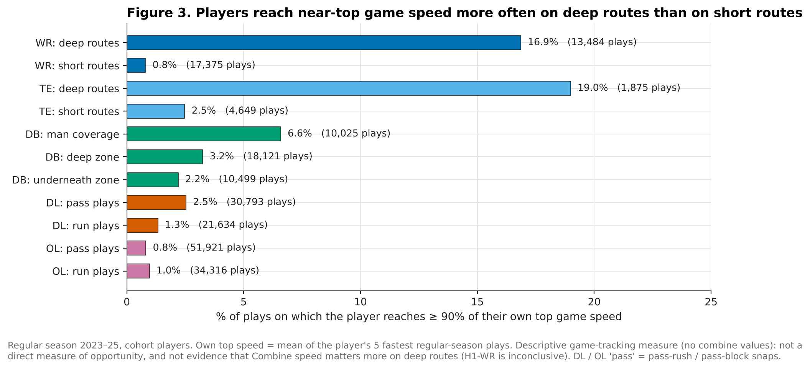
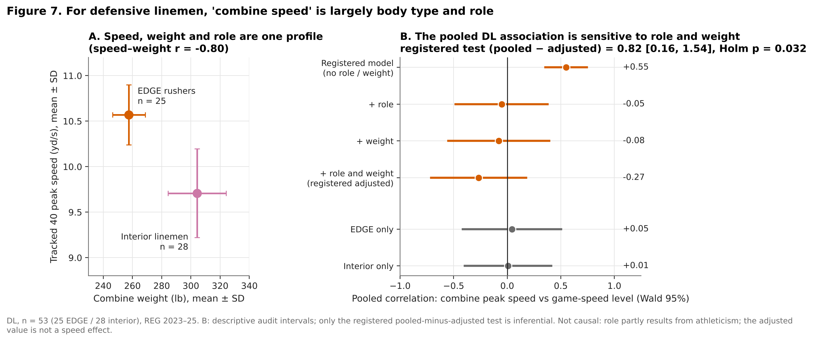

# From Combine Speed to NFL Movement: What Tracking Reveals About Receiver Separation

*NFL Big Data Bowl 2027 · Combine to NFL Performance*

## 1. The question

Every spring, scouts watch a receiver run a 4.38 and ask two different questions: *will he play fast?* and *will he get open?* The 2027 data lets us separate them. For the first time, sensor tracking of the Combine 40 can be linked to the same players' regular-season (REG) tracking for 2023–25.

We keep four things apart throughout (Figure 1):

- **Capacity**: what the athlete can do when asked for maximum effort. Here, the **tracked 40 peak speed** (yd/s), the fastest instant recorded by the Combine sensors.
- **Game movement**: what the player actually does on a snap. Here, the **maximum speed on each REG play** (before the throw for receivers).
- **Football performance**: a result an evaluator cares about. Here, **separation at the throw** (yards to the nearest defender when the pass is released).
- **Deployment**: how the team uses the player. Route mix, coverage faced, alignment (EDGE vs interior) and body weight.

**Our explicit Combine-to-performance analysis is H2:** does tracked top speed tell us anything about deep-route separation *beyond the official 40 time*?

H2 was planned as a primary test. It was **demoted to a secondary, estimation-focused analysis before any Combine-to-game association was examined**, because simulations showed it could not be powered with about 60 receivers. We report it in that status.

## 2. Data and design

- **Cohort.** 510 prospects (2023–25 classes). 418 have at least one valid tracked 40: a clean acceleration curve (R² > 0.95) and a peak ≤ 12.5 yd/s. 332 of them also have REG game rows.
- **Unit of inference: the player, not the play.** Analysed samples (≥ 100 qualifying REG snaps):

| position | players | plays |
|---|---|---|
| WR | 57 | 19,960 |
| DL | 53 | 34,154 |
| OL | 53 | 64,285 |
| DB | 52 | 16,643 |
| TE (descriptive only) | 17 | 4,170 |

- **Safeguards.** The analysis plan was pre-registered and the code frozen before the single Combine-to-game join. The whole pipeline was first run on simulated data with known effects. Each confirmatory script refuses a second run. Only REG plays are used. A faulty game and speed spikes are removed by rule.
- **Model.** A linear mixed model estimates each player's *noise-free* game-speed level in each task context, after pre-snap context: route, coverage shell, down, distance, formation, time-to-throw bin, season and NFL year, with a team-season effect.
  - Its correlation with Combine peak speed (ρ) measures how far Combine speed "shows up" on the field.
  - Intervals come from resampling players (2,000 bootstrap draws). Phase 4 simulations showed this bootstrap is valid but conservative.

## 3. What does Combine tracking add beyond the 40?

- **Tracked top speed is a highly repeatable athlete measurement.** Best-of-two reliability within position is 0.94 (WR) to 0.99 (DL).
- **For receivers and defensive backs it is not the same thing as the 40 time.** About a third of its variance (WR 34%, DB 36%) is not explained by the official 40.
- **The 40 mixes two traits.** In WRs, peak speed and the 10-yard split are only weakly related (ρ = −0.33).
- **For defensive linemen, tracking adds almost nothing.** Peak speed, the 40, the 10-yard split and weight are nearly one dimension: speed–weight r = −0.80, and only 5% of peak-speed variance is unique.

## 4. Players reach near-top game speed more often on deep routes than on short routes

Using game data only, we measured how often a snap pushes a player to within 10% of his own top game speed.

- **WR deep routes do so on 17% of snaps, short routes on 1%.**
- **DL and OL** reach it on 3% of snaps or fewer.

This is a **descriptive game-tracking measure**. It is not a direct measurement of opportunity, and it is not evidence that Combine speed has a stronger effect on deep routes: that question is H1 (next section), and it is inconclusive. The pattern is why the pre-registered test compared deep with short routes.

## 5. Does Combine top speed show up in game speed? (H1)

- **Receivers: yes.** A WR's Combine top speed is associated with how fast he runs in games:
  - ρ = 0.58 on deep routes and 0.49 on short routes;
  - the raw slopes are equal, about 0.11 yd/s of game speed per 0.25 yd/s of Combine speed.
- **The primary test asked whether the link is stronger on deep routes.**
  - **H1-WR: INCONCLUSIVE. Δ = ρ_deep − ρ_short = 0.090, 95% CI [−0.089, 0.400]** (p = 0.21).
  - The interval includes zero, so the deep-route advantage is not supported.
  - It also includes our smallest effect of interest (0.15), so it is not ruled out.
  - Every registered robustness variant gave Δ between 0.07 and 0.12, and a permuted-label control was centred at zero. With 57 receivers, only differences of roughly 0.3 were reliably detectable.
- **Other positions:**
  - **DL** shows a strong pooled association (ρ ≈ 0.55). Section 7 shows why it should not be read as a speed effect.
  - **DB** (ρ 0.09–0.29) and **OL** (0.03–0.11) are weak and imprecise.
  - **TE** (n = 17) is descriptive only.
  - No position shows a resolved task difference. For DL, a pass-rush advantage of 0.15 or more is not supported.

## 6. Does tracked top speed make receivers more open? (H2)

![Figure 5: deep-route separation per SD of tracked speed, −0.7 in [−3.6, +2.3]; held-out R² below the position average.](figures/fig5_h2_separation.png)

This is the Combine-to-performance link. **H2: INCONCLUSIVE. With the official 40 held fixed, β_P = −0.020 yd per SD of tracked peak speed, 95% CI [−0.101, 0.063]** (57 WRs, 9,935 deep routes on thrown passes).

- **No incremental predictive value was detected for tracked peak speed beyond the official 40 for deep-route separation.** The interval rules out a gain larger than about 0.06 yd (about 2 inches) per SD.
- On receivers the models never saw (player-grouped cross-validation), adding tracked speed to the 40 lowered out-of-sample R² by 0.024 (90% lower bound −0.036). Neither model beat the position average.
- A 2025 season-forward check agreed (RMSE change −0.0003 yd).
- Correcting for measurement error in the 40 left the estimate at or below zero for every plausible 40 reliability.

**This does not show that speed has no effect on separation.** The *true-scale* partial correlation could not be estimated, because deep separation is a weak player trait:

- its player-level reliability is **0.44**;
- the between-player SD is 0.13 yd against 1.73 yd of play-to-play variation;
- 60% of bootstrap fits put the player variance at zero.

The data can rule out a large added separation signal from tracked top speed. They cannot rule out a small one.

**Receiver separation measurements are sensitive to route and coverage context.**
- Raw separation looks like a stable receiver trait (reliability 0.81).
- After adjusting for route, coverage, down and formation, it falls to 0.61, and **short-route separation falls from 0.75 to 0.22.** Median separation differs by 1.6 yd between man and zone coverage alone.
- Ranking receivers on raw separation largely ranks how they were used.

## 7. The pooled DL speed association is substantially sensitive to role and body-weight adjustment

- **H1-DL(b) was supported after Holm adjustment (p = 0.032).** The pooled DL association between Combine speed and game speed is **substantially sensitive to role and weight adjustment**:
  - it falls from 0.55 to −0.27 when EDGE/interior role and Combine weight are both adjusted for (registered difference 0.82, 95% CI [0.16, 1.54]);
  - descriptively, role alone (−0.05) or weight alone (−0.08) removes most of it;
  - within EDGE (0.05) and within interior linemen (0.01) it is near zero.
- **This is not a causal statement.** Role is partly *chosen because of* athleticism. The adjusted value is imprecise and depends on the adjustment set, so it must not be read as speed hurting linemen. Speed, weight and role form one athletic profile, and these data cannot separate them.

## 8. What evaluators should take away

| Finding (evidence) | Layer | Practical use |
|---|---|---|
| Tracked top speed is reliable (0.94–0.99) and, for WR/DB, about one-third distinct from the 40 | capacity | Record tracked peak speed alongside the 40; don't treat them as interchangeable for WR/DB |
| WR Combine top speed tracks game top speed about equally on short and deep routes (ρ 0.49–0.58); the deep-route advantage is inconclusive | capacity → movement | Treat tracked peak speed as complementary information about game-speed movement, not as an established predictor of separation |
| Players reach ≥ 90% of their own top game speed on 17% of WR deep routes vs 1% of short routes, ≤ 3% of OL/DL snaps (descriptive) | movement | Expect game top-speed evidence mainly from deep routes; a short-area role rarely shows it |
| No detected added value of tracked speed over the 40 for deep separation; small effects not excluded | capacity → performance | Don't pay a separation premium for tracked top speed alone |
| Raw separation is largely route and coverage context | performance vs deployment | Compare receivers on context-adjusted separation, against the same coverages |
| The pooled DL speed association is substantially sensitive to role and body-weight adjustment | capacity ↔ deployment | Judge a lineman's speed within body type and alignment, not against the whole DL class |

**Limitations:**
- **Player numbers, not plays, limit power.** n ≈ 52–57 per position.
- **Observational.** Usage is partly caused by athleticism.
- **Selection.** Only players with at least 100 qualifying snaps are analysed, which selects largely on draft capital.
- **Movement is not performance.** Game speed is movement, not performance. Separation was the only performance outcome, and it is noisy. DB coverage outcomes cannot be built from these data.
- **Scope.** REG 2023–25 only.

We make no novelty claim. These are pre-registered estimates with honest uncertainty, meant to keep evaluators from reading usage or body type as speed.

## Appendix: methods, reproducibility and references

- **Notebook.** The attached public Kaggle notebook (`11_final_submission`) re-runs, from the competition files:
  - the data validation;
  - the Combine feature definitions;
  - the registered sample sizes.
  
  It loads the registered results (run IDs, code commits and seeds listed) to draw every figure.
- **Confirmatory models are not re-fitted in the notebook.** The registered runners are one-shot by design.
- **Registered runs:**
  - H1-WR: run 20261121T223645Z, seed 4004, B = 2,000.
  - H2: run 20261122T012339Z.
  - Secondary family: run 20261122T015315Z (Holm over H1-DB, H1-DL(a), H1-DL(b), H5(b)).
  - Pipeline validation (Phase 4): null rejection rate ≤ 0.0125 against a nominal 0.025; power 0.45 at Δ = 0.2 and 0.94 at Δ = 0.35.
- **Literature** (DOIs verified; abstracts read; full texts not read):
  - Clark K.P. et al. (2019). *The NFL combine 40-yard dash: how important is maximum velocity?* J Strength Cond Res 33(6):1542–1550. doi:10.1519/JSC.0000000000002081.
  - Morin J-B. et al. (2021). *Individual acceleration-speed profile in-situ: a proof of concept in professional football players.* J Biomech 123:110524. doi:10.1016/j.jbiomech.2021.110524.
